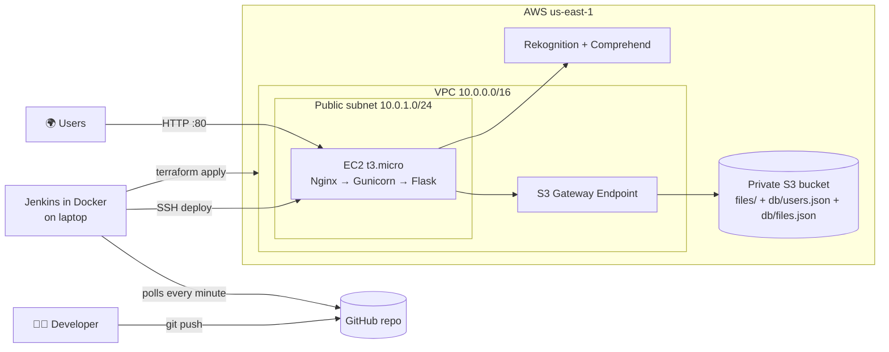

# ☁️ SmartDrive

A mini Google Drive with built-in AI, deployed with **AWS + Terraform + Jenkins + Git**, for **$0**.

- 🔐 Register / log in
- 📁 Upload, download and delete files (up to 10 MB)
- 🤝 Share a file with another user, or create a public link
- 🤖 **AI auto-tags**: photos are tagged by Amazon Rekognition ("Dog", "Beach"), and documents get key phrases from Amazon Comprehend ("invoice", "AWS")
- 🔎 Search your files by name or AI tag

## Architecture



| Tool | What it does in this project |
|---|---|
| **Git / GitHub** | Holds everything (app code, infrastructure, pipeline). A push to `main` is what triggers a deployment. |
| **Jenkins** | Runs the CI/CD pipeline on every push: **Test → Terraform → Deploy → Health check**. |
| **Terraform** | Creates all the AWS infrastructure from one file, [terraform/main.tf](terraform/main.tf). |
| **AWS** | **VPC** (network), **EC2** (web server: Nginx in front of Gunicorn running the Flask app), **S3** (all storage), **IAM** (permissions), **Rekognition + Comprehend** (AI). |

**Where data lives:** everything is in one private S3 bucket. Files are stored under `files/<owner>/…`. User accounts (with hashed passwords) are in `db/users.json`. File records (owner, AI tags, who it's shared with, public link) are in `db/files.json`. The bucket blocks all public access. Only the web server's IAM role can read it, through the S3 VPC endpoint, so file traffic never crosses the public internet.

## Repo layout

```
app/
  app.py             Flask app: auth, upload/download, sharing, search
  ai.py              AI auto-tagging (Rekognition / Comprehend)
  templates/         HTML pages (sign in, create account, file list)
  static/            style.css and app.js (upload, drag-and-drop, share panel)
  test_app.py        tests (run without AWS)
  requirements.txt
terraform/main.tf    ALL infrastructure: VPC, subnet, S3, IAM, EC2
jenkins/Dockerfile   Jenkins image with Python, SSH and Terraform installed
Jenkinsfile          the CI/CD pipeline
PRODUCT.md           who SmartDrive is for and what it does (product facts)
DESIGN.md            the visual design system: colours, type, components, rules
```

## One-time setup

You do these steps once. After that, every `git push` deploys automatically.

### 1. AWS account
1. Sign up at [aws.amazon.com](https://aws.amazon.com) and choose the **Free plan**. On the Free plan you can't be charged; usage comes out of free credits.
2. Go to **Billing → Budgets → Create budget**, choose the **Zero spend budget** template and enter your email. AWS will email you if anything ever costs money.

### 2. IAM user for Jenkins
1. Go to **IAM → Users → Create user**, name it `jenkins-deployer` and attach the policy `AdministratorAccess`.
2. Open the user, then go to **Security credentials → Create access key** and choose "Application running outside AWS".
3. Copy the **Access key ID** and **Secret access key**. You'll need them in step 5. Never commit them to git.

### 3. GitHub repo
Create an empty **public** repo called `smartdrive` on GitHub, then:
```bash
git remote add origin https://github.com/<your-username>/smartdrive.git
git push -u origin main
```

### 4. Start Jenkins (Docker Desktop must be running)
```bash
docker build -t smartdrive-jenkins jenkins/
docker run -d --name jenkins -p 8080:8080 -v jenkins_home:/var/jenkins_home --restart unless-stopped smartdrive-jenkins
docker exec jenkins cat /var/jenkins_home/secrets/initialAdminPassword
```
Open http://localhost:8080 and paste the password. Choose **Install suggested plugins**, then create your admin user.

### 5. Credentials and pipeline job
1. Go to **Manage Jenkins → Credentials → System → Global credentials → Add Credentials**. Add two credentials of kind **Secret text**:

   | ID (type exactly) | Secret |
   |---|---|
   | `aws-access-key-id` | your Access key ID |
   | `aws-secret-access-key` | your Secret access key |

2. Go to **New Item**, name it `smartdrive`, choose **Pipeline** and click OK. In the **Pipeline** section, set:
   - Definition: **Pipeline script from SCM**
   - SCM: **Git**
   - Repository URL: your GitHub repo URL
   - Branch: `*/main`
   - Script Path: `Jenkinsfile`

   Click Save.

### 6. First build
Click **Build Now**. The first run takes about 5–8 minutes because it creates all the AWS resources. At the end, the console output shows:
```
SmartDrive is live at http://<server-ip>
```
This first build also switches on GitHub polling. From now on, **every push to `main` deploys automatically within about a minute.**

## Everyday workflow

```bash
git checkout -b my-change     # work on a branch
# ...edit code...
git commit -am "Describe the change"
git push -u origin my-change  # open a Pull Request on GitHub, then merge it into main
```
After the merge, Jenkins notices the new commit within a minute, then tests, deploys and health-checks it.

## Demo script (for the viva)

1. Show the code, the [Jenkinsfile](Jenkinsfile) and [terraform/main.tf](terraform/main.tf) in GitHub.
2. Open the app and register **user A**. Upload a photo and point out the AI tags. Upload a PDF and point out the key-phrase tags.
3. Search for a tag (e.g. `dog`) to show smart search.
4. Register **user B**, share a file with B from A's account, and show it under **Shared with me** for B.
5. Click **Get public link** and open it in an incognito window. Turn it off and show that the link stops working.
6. **Live CI/CD:** change the "Sign in" heading in `app/templates/login.html`, commit and push. Show Jenkins starting by itself and all four stages going green, then refresh the site.
7. In the AWS console, show the VPC, the subnet, the S3 endpoint, the EC2 instance and the S3 bucket (Block all public access: On, plus the `db/*.json` files).

## Cost: why this is $0

| Resource | Free-tier status |
|---|---|
| 1 × EC2 `t3.micro` + public IP | Free-tier eligible (about $11/month of free credits on new accounts) |
| S3 (a few MB) | A fraction of a cent |
| VPC, subnet, internet gateway, S3 **Gateway** endpoint | Always free |
| Rekognition / Comprehend | Fractions of a cent per upload |
| Jenkins | Runs on your laptop, so free |

The design deliberately has **no NAT gateway, no load balancer, no database and no Elastic IP**, because those are what cost money.

**After the demo**, open the job and click **Build with Parameters**, tick **DESTROY** and click Build. Every AWS resource is deleted. You can bring it all back later by building again with DESTROY unticked.

## Run the tests locally

```bash
python -m venv .venv
.venv\Scripts\activate          # Windows (macOS/Linux: source .venv/bin/activate)
pip install -r app/requirements.txt pytest
pytest app
```
The tests replace S3 and the AI with in-memory fakes, so they need no AWS account.

## Troubleshooting

| Problem | Fix |
|---|---|
| Push doesn't start a build | Click **Build Now** once (that enables polling). Check **Git Polling Log** on the job page. |
| `Could not find credentials entry with ID…` | The credential IDs must be exactly `aws-access-key-id` and `aws-secret-access-key`. |
| Deploy stage stuck on "Waiting for SSH..." | Some college/office Wi-Fi blocks port 22. Try a phone hotspot. |
| Files upload but get no AI tags | Rekognition/Comprehend may not be enabled on your account. Uploads still work; check the server log with `journalctl -u smartdrive`. |
| Site shows "502 Bad Gateway" | Nginx is up but the app isn't. This is normal for a minute while a new server is set up. Otherwise, check `journalctl -u smartdrive` on the server. |
| Jenkins workspace was deleted | Terraform state lived there, so delete the old resources in the AWS console (all are tagged `Project = smartdrive`), then build again. |

## Design choices and limits (good viva questions)

- **JSON files in S3 instead of a database.** This keeps it simple and free. It works because there is one server, and a lock means only one request writes at a time. A real product would use DynamoDB or RDS.
- **No private subnet.** S3 is a regional service and doesn't live inside a subnet. The private path to storage is the **S3 VPC Gateway Endpoint** plus a bucket that blocks all public access.
- **Nginx in front of Gunicorn.** Nginx is the public web server on port 80. It serves the CSS and JS files itself, rejects uploads over 11 MB before they reach the app, and forwards everything else to Gunicorn. Gunicorn listens only on `127.0.0.1:8000`, so the Python app can't be reached directly from the internet.
- **HTTP, not HTTPS.** HTTPS needs a domain and a certificate. In production you'd add a certificate to Nginx (for example with Let's Encrypt), or put CloudFront or a load balancer with an ACM certificate in front.
- **Terraform state lives in the Jenkins workspace.** In production you'd store it in an S3 backend so the whole team can share it.
- **SSH is open only to Jenkins' own IP.** The pipeline detects your laptop's public IP on every run and updates the security group.
